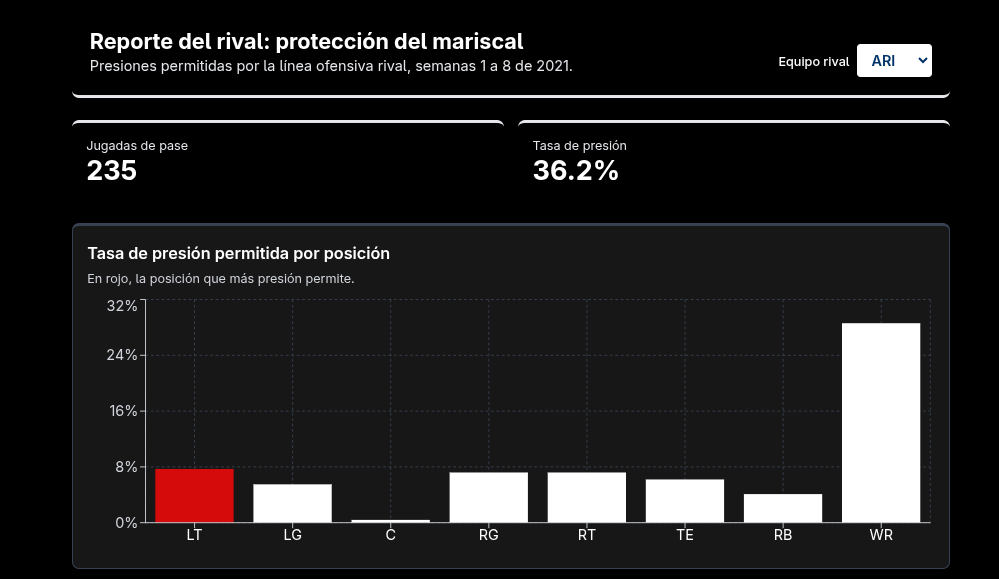
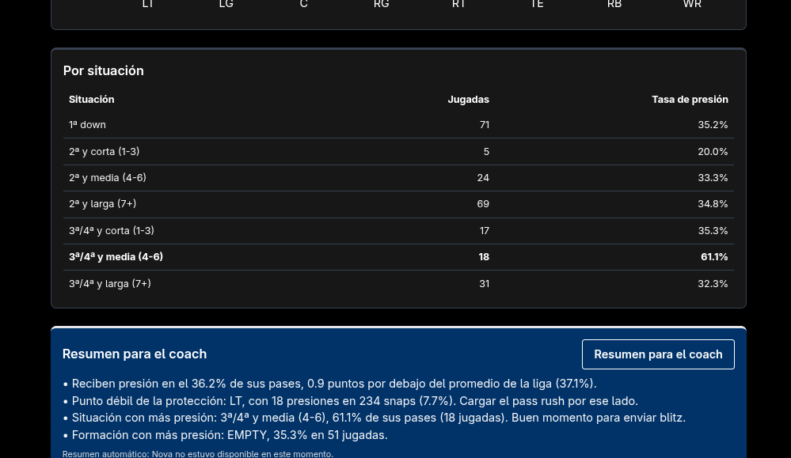

# Presión sobre el mariscal: dónde atacar a tu rival

**Elige al rival. En segundos ves en qué jugadas y con qué bloqueador su línea ofensiva se rompe, y una IA te dice cómo aprovecharlo.**

Proyecto del hackathon NFL Big Data Bowl, UNAM.





## Hallazgo

Con 8,557 jugadas de pase de las semanas 1 a 8 de 2021 (datos de NFL Next Gen Stats y PFF):

### 1. En tercera y larga, la presión llega en la mitad de las jugadas

| Situación | Jugadas con presión |
|---|---|
| 1ª down | 31.7 % |
| 3ª/4ª y media (4-6 yardas) | 44.3 % |
| **3ª/4ª y larga (7+ yardas)** | **50.8 %** |

Cuando el ataque necesita 7 yardas o más, el mariscal recibe presión en 1 de cada 2 jugadas (1,306 jugadas).
Ahí es donde conviene enviar blitz.

### 2. Los tackles son el punto débil de la línea

Probabilidad de que cada posición permita presión en una jugada:

- Tackle derecho (RT): **7.7 %**
- Tackle izquierdo (LT): **7.3 %**
- Guardias: 5.6 % (LG) y 6.5 % (RG)
- Centro (C): **4.1 %**

El RT permite presión casi el doble que el centro. Cargar el pass rush por los extremos rinde más que por el medio.

### 3. Cada rival se rompe en un lugar distinto

La tasa de presión permitida va de **26.2 % (TB)** a **46.3 % (NO)**.
Ejemplo: Kansas City sufre **73.8 %** de presión en 3ª/4ª y larga (42 jugadas), y su RT es el eslabón más débil de la línea, con 9.1 %.
Por eso el reporte se arma por equipo, y no con un promedio de la liga.

## Qué hace la app

Está pensada para el cuerpo técnico defensivo que prepara el partido contra un rival.

1. Se elige el equipo rival.
2. Se ven su tasa de presión, la gráfica por posición de la línea y la tabla por down y distancia.
3. El botón **Resumen para el coach** envía el reporte a Amazon Nova, que devuelve de 4 a 5 recomendaciones: por qué lado cargar el pass rush y en qué downs mandar blitz, cada una con la cifra que la respalda.

Si la IA falla, el reporte sigue funcionando.

**Cómo definimos presión:** una jugada de pase cuenta como "con presión" si algún pass rusher registró hurry, hit o sack según PFF.
Son solo 8 semanas, así que los grupos con pocas jugadas son poco estables, y la IA ignora los de menos de 15. Las tasas describen lo ocurrido, no demuestran la causa.

## Correrlo

Para el resumen de IA, copiar `.env.example` a `.env` con las llaves del workshop.

```
.venv/bin/uvicorn backend.main:app          # Windows: .venv/Scripts/uvicorn
cd dashboard && npm install && npm run dev  # abre http://localhost:5173
```

Backend FastAPI + pandas. Dashboard React, Vite, Tailwind y Recharts. IA con Amazon Nova en Bedrock, vía Strands Agents.
Rutas principales: `GET /api/equipos`, `GET /api/rival/{equipo}` y `POST /api/rival/{equipo}/resumen`.
